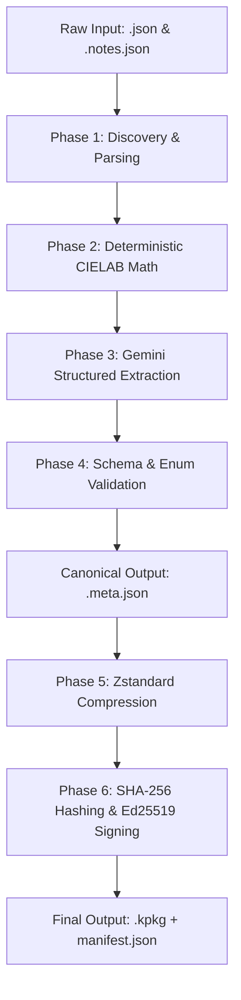

# Implementation Plan: KoColor Catalog Tagging Pipeline

This document outlines the end-to-end architecture and execution steps required to upgrade the KoColor raw catalog assets into deterministic, `metadataVersion: 1` Wardrobe Catalog Records.

By running this pipeline, we will combine mathematically perfect color telemetry with Gemini-extracted structured taxonomy, eliminating the "empty manifest" hallucination bugs and establishing a robust foundation for the Android `DeterministicWardrobeEngine`.

---

## 1. Pipeline Architecture Overview

The tagging pipeline is a unidirectional data flow that processes raw product descriptions and outputs signed, highly-compressed `.kpkg` distribution bundles.



---

## 2. Phase Breakdown

### Phase 1: Tooling & Script Setup
**Goal:** Establish the execution orchestrator (`tag_pipeline.py`).
1. **Directory Scanning:** The script will recursively traverse `server/Inventory/package/input/KoColor/`.
2. **Data Amalgamation:** For every target, it pairs `kc-[type]-[id].json` (containing raw hex, price, ingredients) with its sibling `kc-[type]-[id].notes.json` (containing the editorial description and technical overview).
3. **Environment Checks:** Verify the presence of `GEMINI_API_KEY` for Phase 3 and the `atelier-dev-01` private key for Phase 6.

### Phase 2: Deterministic Color Math
**Goal:** Pre-compute mathematical color values locally before AI interaction.
* **Why:** LLMs are notorious for failing at floating-point arithmetic. They should never guess color space coordinates.
* **Process:** The script implements standard D65 illuminant matrices:
  1. Parse `#RRGGBB` into sRGB floats (0.0 - 1.0).
  2. Transform sRGB $\rightarrow$ XYZ (D65).
  3. Transform XYZ $\rightarrow$ CIELAB ($L^*$, $a^*$, $b^*$).
  4. Transform CIELAB $\rightarrow$ LCh (Chroma $C^*$, Hue Angle $h^\circ$).
* **Output:** A sealed `ColorIntelligence` JSON sub-object ready for injection into the final record.

### Phase 3: AI Taxonomy Enrichment (Gemini API)
**Goal:** Extract complex structural rules from raw prose into strictly validated enums.
* **Model:** `gemini-1.5-flash` or `gemini-1.5-pro` (via the `google-genai` Python SDK).
* **Mode:** **Structured Outputs** (`response_mime_type = "application/json"`).
* **Prompt Injection:**
  * **System Instruction:** The exact master prompt from `Instructions.md`, containing the "Controlled Vocabulary" and "Garment Construction Derivation Matrix".
  * **User Prompt:** A structured string containing the item's name, composition (`ingredients`), price, and editorial descriptions.
* **Extraction:** Gemini will classify the item into `Category`, `Formality`, `LayeringRole`, `ThermalWeight`, etc., using ONLY the permitted enums.

### Phase 4: Validation & Merging
**Goal:** Guarantee deterministic safety for the Android client.
1. **Schema Merge:** The script overwrites the LLM's `color` block with the mathematically perfect CIELAB block generated in Phase 2.
2. **Enum Validation:** Pydantic (or strict JSON schema validation) asserts that arrays like `occasionTags` contain no typos (e.g., rejecting `["Business"]` in favor of `["BUSINESS"]`).
3. **Hard-Filter Guardrail Validation:**
   * *Rule:* Every wearable item (TOPS, BOTTOMS, SHOES, OUTERWEAR) MUST have at least one `occasionTag` and at least one `thermalSuitability` band.
   * *Fallback:* If missing, the item is flagged for manual review, preventing it from being silently dropped by the Android pruning engine.
4. **File Output:** Save the unified record as `kc-[type]-[id].meta.json`.

### Phase 5 & 6: Recompilation & Signature (.kpkg generation)
**Goal:** Prepare the data for atomic CDN deployment and Android client consumption.
1. **Minification:** Read all `.meta.json` files and minify them (removing whitespace/newlines) to create a single contiguous JSON array.
2. **Zstandard Compression:** Execute `zstd -19 --ultra` to compress the JSON array into a highly optimized binary blob (e.g., `kocolor-vault.kpkg`).
3. **Hashing & Signing:**
   * Compute the SHA-256 digest of the `.kpkg` file.
   * Sign the `.kpkg` binary using the `atelier-dev-01` Ed25519 private key.
4. **Manifest Generation:** Write the hash, signature, and byte sizes into `manifest.json`, and sign the master envelope.

---

## 3. Data Schema Example

Once Phase 4 completes, the raw JSON/notes pairs will be transformed into this canonical format:

```json
{
  "itemId": "kc-active-805",
  "name": "Arcadia Blue Track Jacket",
  "category": "OUTERWEAR",
  "productType": "TRACK_JACKET",
  "commercial": {
    "priceUsd": 85.0,
    "volumeOrSize": "Size M",
    "sustainabilityGrade": "GRADE_A"
  },
  "occasionTags": ["ACTIVE", "CASUAL", "EVERYDAY", "TRAVEL"],
  "formality": "CASUAL",
  "thermalSuitability": ["MILD", "COOL"],
  "thermalProvenance": "DERIVED_FROM_CONSTRUCTION",
  "weatherProtection": ["WIND_RESISTANT"],
  "construction": {
    "thermalWeight": "MIDWEIGHT",
    "breathability": "MEDIUM",
    "insulation": "NONE",
    "features": ["RIBBED_CUFFS", "ZIP_POCKETS", "FULL_ZIP"],
    "provenance": "DERIVED_FROM_CONSTRUCTION"
  },
  "layeringRole": "OUTER_LAYER",
  "compatibleLayeringRoles": ["OUTER_LAYER", "MID_LAYER"],
  "silhouette": "FITTED",
  "seasons": ["SPRING", "AUTUMN", "WINTER"],
  "activities": ["EXERCISE", "WALKING", "CYCLING", "LOUNGE"],
  "color": {
    "hex": "#252C58",
    "colorName": "Arcadia Blue",
    "hueFamily": "BLUE",
    "temperature": "COOL",
    "lStar": 19.64,
    "aStar": 11.55,
    "bStar": -27.62,
    "cStar": 29.94,
    "hDeg": 292.7
  },
  "material": {
    "composition": [
      {
        "material": "TRICOT_POLYESTER",
        "percentage": 100
      }
    ]
  },
  "metadataVersion": 1
}
```
