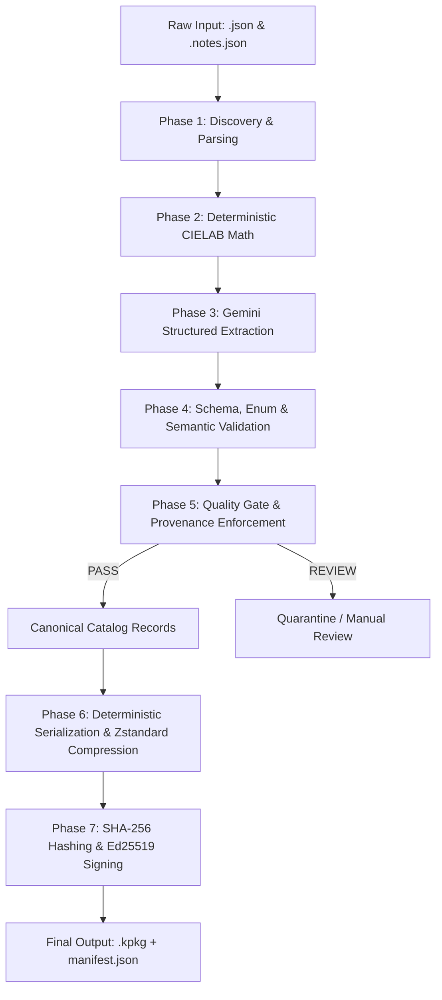

# Implementation Plan: KoColor Catalog Tagging Pipeline

This pipeline combines deterministic color telemetry with AI-assisted structured taxonomy enrichment to produce versioned, validated KoColor Catalog Records. Provenance tracking, semantic validation, and candidate-availability checks reduce classification errors and prevent unsupported metadata from silently entering the recommendation pipeline. The resulting catalog provides a structured foundation for the Android `DeterministicWardrobeEngine`.

---

## 1. Pipeline Architecture Overview

The tagging pipeline is a unidirectional data flow that processes raw product descriptions and outputs signed, highly-compressed `.kpkg` distribution bundles.



---

## 2. Phase Breakdown

### Phase 1: Tooling & Script Setup
**Goal:** Establish the execution orchestrator (`tag_pipeline.py`).
1. **Directory Scanning:** The script will recursively traverse `server/Inventory/package/input/KoColor/`.
2. **Data Amalgamation:** For every target, it pairs `kc-[type]-[id].json` (containing raw hex, price, ingredients) with its sibling `kc-[type]-[id].notes.json` (containing the editorial description and technical overview).
3. **Environment Checks:** Verify the presence of `GEMINI_API_KEY` for Phase 3 and the appropriate signing keys (`atelier-dev-01` or production equivalent) for Phase 7.

### Phase 2: Deterministic Color Math
**Goal:** Pre-compute mathematical color values locally before AI interaction.
* **Why:** LLMs are notorious for failing at floating-point arithmetic. They should never guess color space coordinates.
* **Process:** Deterministic color telemetry derived from the catalog's declared sRGB color values using a versioned D65 CIELAB conversion pipeline:
  1. Parse `#RRGGBB` into sRGB floats (0.0 - 1.0).
  2. Transform sRGB $\rightarrow$ XYZ (D65, 2° observer).
  3. Transform XYZ $\rightarrow$ CIELAB ($L^*$, $a^*$, $b^*$).
  4. Transform CIELAB $\rightarrow$ LCh (Chroma $C^*$, Hue Angle $h^\circ$ normalized to `[0°, 360°)`).
* **Output:** A sealed `ColorIntelligence` JSON sub-object ready for injection into the final record. (Note: "temperature" will be mapped to "colorTemperature" to avoid confusion with thermal suitability).

### Phase 3: AI Taxonomy Enrichment (Gemini API)
**Goal:** Extract complex structural rules from raw prose into strictly validated enums.
* **Model:** Configurable supported model (e.g., `gemini-3.8-flash`) via the `google-genai` Python SDK.
* **Mode:** **Structured Outputs** (`response_mime_type = "application/json"` and explicit `response_schema` using Pydantic).
* **Prompt Injection:**
  * **System Instruction:** The exact master prompt containing the "Controlled Vocabulary" and "Garment Construction Derivation Matrix".
  * **User Prompt:** A structured string containing the item's name, composition (`ingredients`), price, and editorial descriptions.
* **Extraction:** Gemini will classify the item into `Category`, `Formality`, `LayeringRole`, `ThermalWeight`, etc., using ONLY the permitted enums. The prompt will enforce separation between catalog `category` (e.g., `ACTIVEWEAR`) and functional `layeringRole` (e.g., `OUTER_LAYER`).

### Phase 4: Schema, Enum, & Semantic Validation
**Goal:** Guarantee deterministic safety and semantic correctness for the Android client.
1. **Deterministic Color Merge:** The script preserves the authoritative source HEX value and replaces all LLM-generated color calculations with the versioned, deterministically computed color-intelligence fields from Phase 2. The resulting measurements are reproducible for the same source HEX value and color-algorithm version.
2. **Enum & Field Validation:** Pydantic (or strict JSON schema validation) asserts that arrays like `occasionTags` contain no typos. It validates the separation of shared catalog fields from wardrobe- and cosmetics-specific schemas.

### Phase 5: Quality Gate & Provenance Enforcement
**Goal:** Enforce data trustworthiness and prevent silent failures.
1. **Provenance Validation:** EVERY inferred or derived field (e.g., `thermalSuitability`, `weatherProtection`, `formality`) must have an explicit provenance tag (`SOURCE_VERIFIED`, `RULE_DERIVED`, `LLM_SUGGESTED`, `HUMAN_REVIEWED`, or `UNKNOWN`).
2. **Catalog Completeness Policy:**
    * Every item must have a valid category and product type.
    * Every item must have a valid identity and source-color state.
    * Missing occasion or thermal information must be represented explicitly. `UNKNOWN` is permitted where evidence is insufficient.
    * Items must NOT be silently discarded because a required facet is missing. Hard filters must NOT treat `UNKNOWN` as verified eligibility.
3. **Quality Report:** The gate produces a report detailing counts for verified, rule-derived, AI-suggested, unknown, rejected, and review-required attributes. Items failing the gate are sent to Quarantine.

### Phase 6 & 7: Deterministic Recompilation & Signature (.kpkg generation)
**Goal:** Prepare reproducible, secure data for atomic CDN deployment.
1. **Deterministic Serialization:** Read all approved `.meta.json` records, sort them deterministically by stable `itemId`, and serialize them using a documented encoding policy (e.g., minified UTF-8, canonical key ordering).
2. **Zstandard Compression:** Execute `zstd -19 --ultra` (benchmarked for compatibility) to compress the serialized array into a `.kpkg` binary payload.
3. **Hashing & Signing Contract:**
   * Compute the SHA-256 digest of the *exact compressed bytes*.
   * Sign the package digest and associated version metadata using Ed25519 (separating development keys like `atelier-dev-01` from securely held production keys).
4. **Manifest Generation:** Generate a release manifest containing the digest, signature, key ID, package version, schema version, taxonomy version, color algorithm version, rule version, compressed size, uncompressed size, and compression format.
5. **Envelope Signature:** Sign the canonical manifest envelope (excluding the signature field itself).

---

## 3. Data Schema Architecture

The canonical format separates shared metadata from domain-specific fields, explicitly tracking provenance at the field level:

```json
{
  "CommonMetadata": {
    "itemId": "kc-active-805",
    "name": "Arcadia Blue Track Jacket",
    "source": "INTERNAL",
    "commercial": {
      "priceUsd": 85.0,
      "volumeOrSize": "Size M",
      "sustainabilityGrade": "GRADE_A"
    },
    "color": {
      "hex": "#252C58",
      "colorName": "Arcadia Blue",
      "hueFamily": {
        "value": "BLUE",
        "provenance": "RULE_DERIVED"
      },
      "colorTemperature": {
        "value": "COOL",
        "provenance": "RULE_DERIVED"
      },
      "lStar": 19.64,
      "aStar": 11.55,
      "bStar": -27.62,
      "cStar": 29.94,
      "hDeg": 292.7,
      "colorAlgorithmVersion": "1.0.0"
    },
    "material": {
      "composition": [
        {
          "material": "TRICOT_POLYESTER",
          "percentage": 100
        }
      ]
    },
    "metadataVersion": 1,
    "ruleVersion": "1.0.0"
  },
  "WardrobeMetadata": {
    "catalogCategory": "ACTIVEWEAR",
    "productType": "TRACK_JACKET",
    "occasionTags": {
      "values": ["EVERYDAY", "TRAVEL"],
      "provenance": "LLM_SUGGESTED"
    },
    "formality": {
      "value": "CASUAL",
      "provenance": "LLM_SUGGESTED"
    },
    "thermalSuitability": {
      "values": ["MILD", "COOL"],
      "provenance": "RULE_DERIVED",
      "derivationMethod": "GARMENT_CONSTRUCTION",
      "ruleVersion": "thermal-rules-1"
    },
    "weatherProtection": {
      "values": ["WIND_RESISTANT"],
      "provenance": "LLM_SUGGESTED"
    },
    "construction": {
      "thermalWeight": {
        "value": "MIDWEIGHT",
        "provenance": "RULE_DERIVED"
      },
      "breathability": {
        "value": "MEDIUM",
        "provenance": "UNKNOWN"
      },
      "insulation": {
        "value": "NONE",
        "provenance": "RULE_DERIVED"
      },
      "features": ["RIBBED_CUFFS", "ZIP_POCKETS", "FULL_ZIP"],
      "derivationMethod": "GARMENT_CONSTRUCTION"
    },
    "layeringRole": {
      "primary": "OUTER_LAYER",
      "compatible": ["OUTER_LAYER", "MID_LAYER"],
      "provenance": "LLM_SUGGESTED"
    },
    "silhouette": {
      "value": "FITTED",
      "provenance": "LLM_SUGGESTED"
    },
    "seasons": {
      "values": ["SPRING", "AUTUMN", "WINTER"],
      "provenance": "LLM_SUGGESTED"
    },
    "activities": {
      "values": ["EXERCISE", "WALKING", "CYCLING", "LOUNGE"],
      "provenance": "LLM_SUGGESTED"
    }
  }
}
```

## 4. Required Runtime Enforcement (Android Engine)

The tagging pipeline is only half the solution. The Android `DeterministicWardrobeEngine` must enforce the following rules:
1. **Provenance Policy:** Hard environmental exclusions (e.g., weather bans) should only rely on explicitly approved data (`SOURCE_VERIFIED`, `HUMAN_REVIEWED`, or valid `RULE_DERIVED`). `LLM_SUGGESTED` attributes may only be used for soft ranking unless independently verified.
2. **Preflight Candidate Checks:** Before invoking the LLM, the engine must verify that each required outfit role has at least one eligible candidate. If a required role (e.g., `SHOES`) has zero eligible candidates, the pipeline must explicitly fail or invoke a documented fallback relaxation policy. The LLM must *never* be asked to fill a missing role from outside the validated candidate set.
